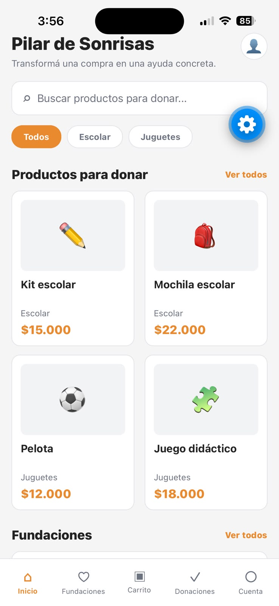

# Home y componentes de interfaz

**Responsable:** Micaela

**Requisitos relacionados:** RF-001, RF-002, RF-006

## Archivos principales

* `src/screens/HomeScreen.js`
* `src/components/SearchBar.js`
* `src/components/ProductCard.js`
* `src/components/FoundationCard.js`

## Qué hace el módulo

El módulo Home es la pantalla principal de Pilar de Sonrisas. Permite buscar productos para donar, filtrarlos por categoría, visualizar los productos disponibles y conocer las fundaciones.

Además, mantiene la navegación principal de la aplicación y permite acceder al detalle de productos y fundaciones.

## Componentes / funciones principales

| Componente o función | Archivo             | Qué hace                                                                      | Datos que usa/cambia                            |
| -------------------- | ------------------- | ----------------------------------------------------------------------------- | ----------------------------------------------- |
| HomeScreen           | `HomeScreen.js`     | Muestra la pantalla principal, buscador, categorías, productos y fundaciones. | `search`, `category`, `products`, `foundations` |
| SearchBar            | `SearchBar.js`      | Permite ingresar texto para buscar productos.                                 | `value`, `onChangeText`, `placeholder`          |
| ProductCard          | `ProductCard.js`    | Muestra cada producto mediante una tarjeta reutilizable.                      | `product`, `onPress`                            |
| FoundationCard       | `FoundationCard.js` | Muestra cada fundación mediante una tarjeta reutilizable.                     | `foundation`, `onPress`                         |
| visibleProducts      | `HomeScreen.js`     | Filtra los productos según el texto ingresado y la categoría seleccionada.    | `search`, `category`, `products`                |

## Datos y estado

* `search`: almacena el texto ingresado en el buscador.

* `category`: almacena la categoría seleccionada.

* `products`: datos de los productos utilizados en Home.

* `foundations`: datos de las fundaciones mostradas en Home.

* Los productos se obtienen desde `src/data/products.js`.

* Las fundaciones se obtienen desde `src/data/foundations.js`.

No se agregó lógica propia de carrito ni de autenticación.

## Navegación

* Se llega desde: la navegación principal de la aplicación.

* Puede navegar a: detalle de producto y detalle de fundación/listado de fundaciones.

* Parámetros enviados:

  * Producto: `productId`

  * Fundación: `foundationId`

También se mantiene la `BottomNav` existente.

## Validaciones / estados especiales

* Si no se encuentran productos para la búsqueda o categoría seleccionada, se muestra un mensaje indicando que no se encontraron productos.

* La búsqueda no distingue entre mayúsculas y minúsculas.

* Se pueden seleccionar las categorías disponibles para filtrar los productos.

## Prueba manual

1. Abrir la aplicación en Expo Go.

2. Verificar que se muestre correctamente la pantalla Home.

3. Escribir un producto en el buscador y comprobar que se filtre.

4. Seleccionar una categoría y comprobar el filtrado.

5. Tocar un producto y verificar que navegue correctamente a su detalle.

6. Tocar una fundación y verificar que navegue correctamente.

7. Verificar que la Bottom Navigation continúe funcionando.

**Resultado esperado:** la pantalla Home se muestra correctamente, permite buscar y filtrar productos, muestra las fundaciones y permite navegar a los detalles correspondientes sin errores.

## Capturas

Guardar capturas en `docs/img/`.

```md

```
