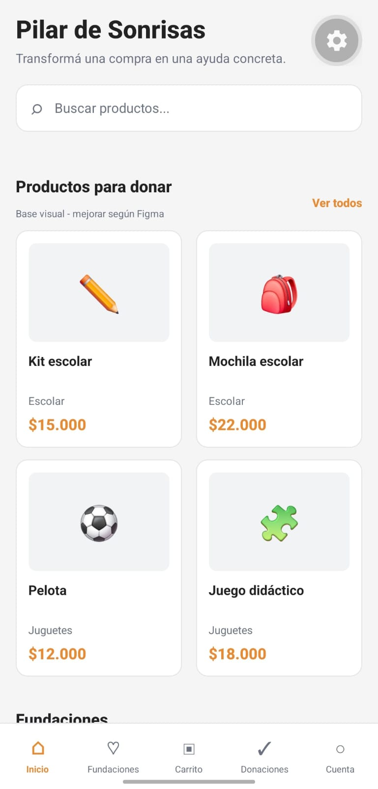
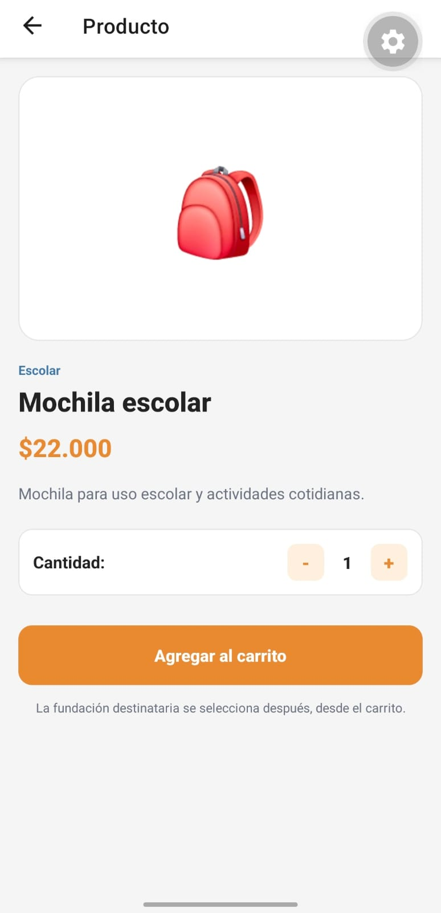

# Catálogo y productos

**Responsable:** Juan  
**Requisitos relacionados:** RF-001, RF-002, RF-003, RF-004

## Archivos principales

- `src/screens/CatalogScreen.js`
- `src/screens/ProductScreen.js`
- Componentes reutilizados: Tarjetas de productos, barra de búsqueda y botones de navegación.

## Qué hace el módulo

Permite a los usuarios visualizar el listado general de productos disponibles para donar (con su categoría, título y precio) y acceder a una vista detallada de cada producto para consultar su descripción completa y seleccionar la cantidad antes de agregarlo al carrito.

## Funciones principales

| Función | Archivo | Qué hace | Datos que usa/cambia |
|---|---|---|---|
| Renderizado del listado | `CatalogScreen.js` | Muestra las tarjetas con los productos disponibles | Lee el listado general de productos |
| Selección de producto | `CatalogScreen.js` | Navega a la vista de detalle al hacer clic en un producto | Pasa el ID o los datos del producto seleccionado |
| Ajuste de cantidad | `ProductScreen.js` | Incrementa o decrementa las unidades a donar | Modifica el estado local de cantidad |

## Búsqueda y filtros

El módulo cuenta con una barra de búsqueda superior que permite filtrar los productos en tiempo real ingresando palabras clave relacionadas con el título o la categoría.

## Integración con el carrito

Permite enviar el producto seleccionado junto con la cantidad elegida directamente al `CartContext` mediante la acción de agregar al carro al presionar el botón correspondiente en la vista de detalle.

## Navegación

- Se llega desde: Pantalla de inicio (Home) o solapa de navegación inferior.
- Puede navegar a: Pantalla de detalle de producto (`ProductScreen.js`).
- Parámetros recibidos/enviados: Identificador del producto seleccionado para mostrar su información específica.

## Prueba manual

1. Abrir el catálogo.
2. Buscar o filtrar un producto (ej. "Mochila escolar").
3. Abrir su detalle.
4. Ajustar la cantidad y agregarlo al carrito.
5. Resultado esperado: El producto se añade correctamente al carrito y se visualiza en la pantalla correspondiente.

## Capturas

