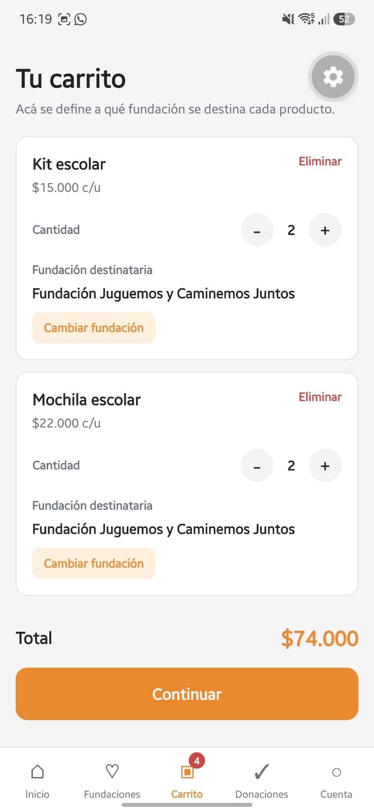
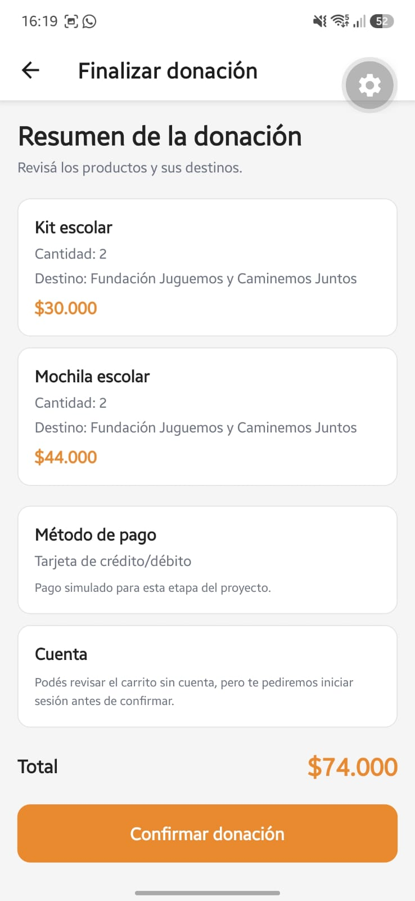
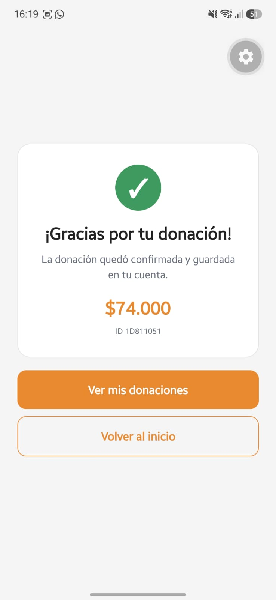

# Carrito y donación

**Responsable:** Joaquín Pajon  
**Requisitos relacionados:** RF-004, RF-005, RF-009, RF-010

## Archivos principales

- `src/screens/ProductScreen.js`
- `src/screens/CartScreen.js`
- `src/screens/CheckoutScreen.js`
- `src/screens/ConfirmationScreen.js`
- `src/context/CartContext.js`
- `src/config/supabase.js`

## Qué hace el módulo

Implementa el flujo de donación desde la selección de productos hasta la confirmación. El usuario define cantidades y revisa el resumen. Para los productos comerciales, la fundación destinataria viene determinada por la necesidad que motivó su publicación y no puede cambiarse. Al confirmar, la donación y sus ítems se persisten en Supabase y luego quedan disponibles en `Mis donaciones`.

## Funciones principales

| Función | Archivo | Qué hace | Datos que usa/cambia |
|---|---|---|---|
| `addToCart(product, quantity)` | `CartContext.js` | Agrega un producto o suma la cantidad seleccionada si ya existe | `cart` |
| `increaseQuantity(productId)` | `CartContext.js` | Incrementa la cantidad de un producto | `cart` |
| `decreaseQuantity(productId)` | `CartContext.js` | Disminuye la cantidad sin bajar de 1 | `cart` |
| `removeFromCart(productId)` | `CartContext.js` | Elimina un producto del carrito | `cart` |
| `assignFoundation(productId, foundationId)` | `CartContext.js` | Asigna o cambia la fundación destinataria de un producto | `cart` |
| `clearCart()` | `CartContext.js` | Vacía el carrito después de una confirmación exitosa | `cart` |
| `handleConfirm()` | `CheckoutScreen.js` | Valida sesión/carrito y guarda la donación mediante `create_donation` | Supabase + `cart` |

## Selección de fundación

Cada producto comercial tiene una fundación destinataria determinada por su necesidad en `foundation_needs`. Aunque el carrito admite productos de distintas fundaciones, el usuario no puede reasignar manualmente el destino de una publicación comercial. `assignFoundation` conserva su uso para ítems que no tengan el destino bloqueado.

## Validaciones

- El carrito debe contener al menos un producto.
- Cada producto debe tener una fundación asignada antes de continuar.
- Para confirmar y guardar la donación el usuario debe iniciar sesión.
- Si Supabase devuelve un error, el carrito no se vacía y la app informa el problema.

## Checkout y confirmación

`CheckoutScreen` muestra los productos, cantidades, fundaciones destinatarias, subtotales, total y la leyenda de pago simulado. Al confirmar, llama a la función RPC `create_donation` de Supabase. Si el guardado finaliza correctamente, se vacía el carrito y se navega a `ConfirmationScreen` con el ID y total de la donación.

`ConfirmationScreen` muestra el mensaje de éxito, el total, un identificador corto de la donación y accesos para ir a `Mis donaciones` o volver al inicio.

## Prueba manual

1. Abrir un producto y seleccionar una cantidad mayor a 1.
2. Agregarlo al carrito y verificar que se conserve la cantidad elegida.
3. Agregar otro producto si se desea.
4. Cambiar cantidades con `+` y `-`.
5. Verificar que cada publicación comercial ya tenga asignada la fundación de su necesidad y que no pueda cambiarse.
6. Verificar que la app valide el destino de todos los productos antes de continuar.
7. Continuar al checkout y revisar el resumen.
8. Confirmar la donación con una cuenta iniciada.
9. Verificar la pantalla de confirmación.
10. Abrir `Mis donaciones` y comprobar que la donación recién creada aparezca en el historial.

## Capturas

