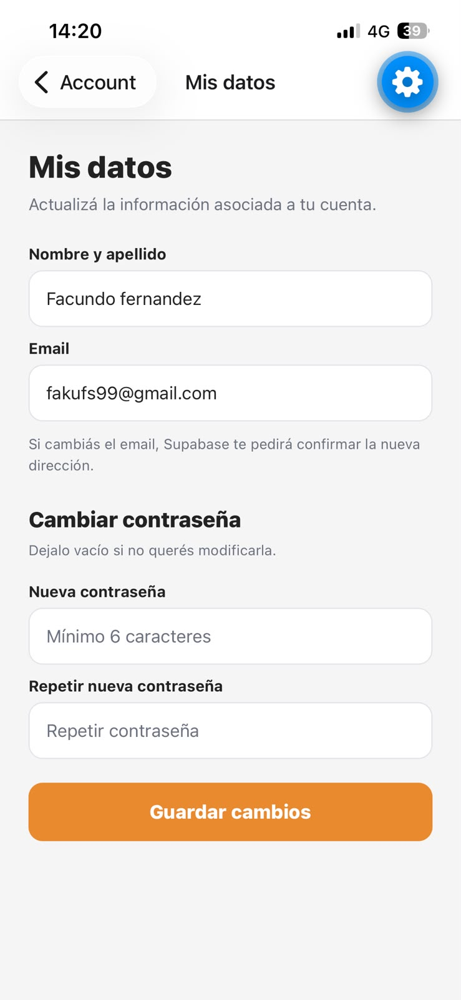
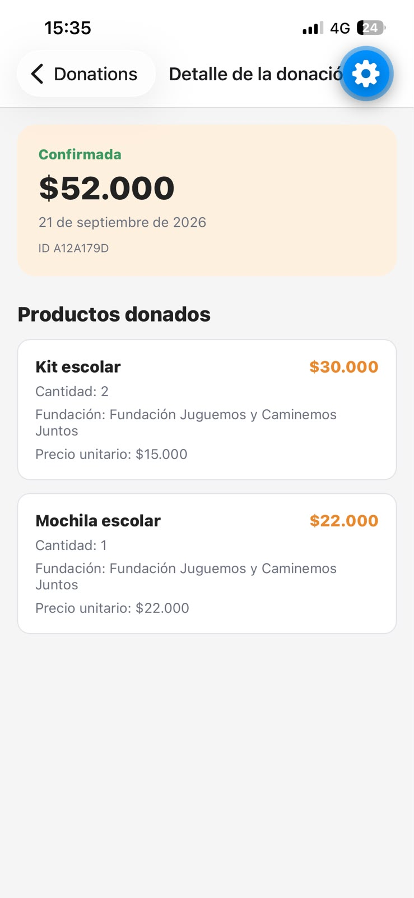
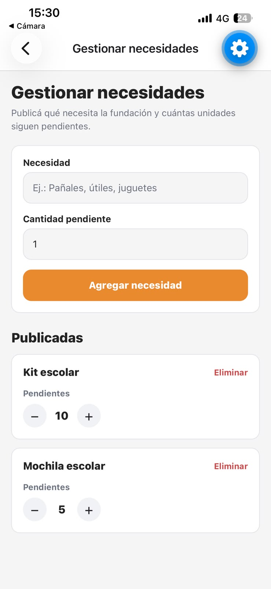

# Cuenta, autenticación y fundación

**Responsables:** Facundo (UI) + Nicolás (integración Supabase)  
**Requisitos relacionados:** RF-007, RF-008, RF-010, RF-011, RF-012, RF-013, RF-014, RF-015, RF-016

## Qué hace el módulo

Agrupa el acceso de donantes y fundaciones. El catálogo y el carrito pueden usarse sin iniciar sesión; la cuenta se vuelve obligatoria al confirmar una donación para poder asociarla al usuario y guardarla en el historial.

## Archivos principales

- `src/screens/AccountScreen.js`
- `src/screens/ProfileScreen.js`
- `src/screens/LoginScreen.js`
- `src/screens/RegisterScreen.js`
- `src/screens/DonationsScreen.js`
- `src/screens/DonationDetailScreen.js`
- `src/screens/FoundationPanelScreen.js`
- `src/screens/FoundationNeedsScreen.js`
- `src/context/AuthContext.js`
- `src/config/supabase.js`

## Cuenta de donante

### AccountScreen

Muestra dos estados: sin sesión y con sesión. Con sesión permite abrir Mis datos, Mis donaciones y cerrar sesión. Cuando corresponde, incorpora el acceso diferenciado al panel de comercios.

### ProfileScreen

Permite actualizar:

- nombre y apellido;
- email;
- contraseña de forma opcional;
- nombre comercial (`profiles.business_name`), solo para cuentas `merchant`, publicado como `merchant_name` en los productos.

El nombre se guarda en `public.profiles` y en metadata de Supabase Auth. Si se cambia el email, Supabase solicita confirmar la nueva dirección.

### RegisterScreen

Crea una cuenta mediante Supabase Auth. Si la confirmación de email está activa, el usuario debe confirmar el correo antes de iniciar sesión. También permite reenviar la confirmación.

Validaciones:

- campos obligatorios;
- contraseña de al menos 6 caracteres;
- contraseñas coincidentes;
- aceptación de términos.

### LoginScreen

Inicia sesión con email y contraseña. Distingue los errores de credenciales y email sin confirmar. En este último caso permite reenviar el correo de confirmación.

Cuando Login fue abierto desde Checkout, al ingresar vuelve al Checkout para completar la donación.

### AuthContext

- recupera la sesión persistida;
- valida contra Supabase que el usuario siga existiendo;
- limpia sesiones locales inválidas, por ejemplo cuando un usuario fue borrado desde el dashboard;
- carga el perfil;
- expone cierre de sesión y actualización de perfil.

## Donaciones

### CheckoutScreen

Al confirmar:

1. comprueba que haya sesión;
2. valida carrito y fundación por producto;
3. ejecuta `create_donation` en Supabase;
4. guarda cabecera y detalle en una única transacción;
5. limpia el carrito solo si la persistencia fue exitosa;
6. muestra Confirmación.

### DonationsScreen

Consulta exclusivamente las donaciones del usuario autenticado mediante RLS. Si la cuenta es nueva, el historial aparece vacío. Al crear una nueva donación, aparece al volver al historial.

### DonationDetailScreen

Muestra datos reales de la donación seleccionada: fecha, total, productos, cantidades, precio unitario y fundación destinataria.

## Cuenta de comercio

Las cuentas se registran inicialmente como `donor` y se habilitan administrativamente con el rol `merchant`. Un comercio puede editar su nombre público en **Mis datos**, además de acceder al panel para crear y editar publicaciones propias. El comercio no puede modificar su rol ni publicaciones ajenas. La descripción completa está en `09-comercios.md`.

## Cuenta de Fundación

Las cuentas públicas se crean siempre con rol `donor`. Una cuenta de Fundación debe ser habilitada por un administrador con:

- `role = 'foundation'`;
- `foundation_id` correspondiente.

Un usuario común no tiene permisos SQL para modificar su propio rol.

### FoundationPanelScreen

- valida rol y Fundación asociada;
- muestra cantidad real de donaciones recibidas;
- muestra cantidad real de necesidades publicadas;
- conserva pruebas de cámara y GPS;
- permite cerrar sesión;
- abre la gestión de necesidades.

El botón de captura permanece deshabilitado hasta que la cámara avisa que está lista (`onCameraReady`), y la toma de la foto está protegida para no dejar promesas sin manejar.

### FoundationNeedsScreen

Permite a una Fundación:

- agregar necesidades;
- modificar la cantidad pendiente;
- eliminar necesidades.

RLS restringe esas operaciones a la Fundación asociada al usuario.

## Capturas

Las imágenes están en `docs/img/`.

### Cuenta de donante

**Cuenta sin sesión** — dos accesos: donante (iniciar sesión / crear cuenta) y organizaciones.

**Iniciar sesión** — ingreso con email y contraseña, con recuperación de contraseña y acceso de fundación.

**Crear cuenta** — registro de donante con validación de campos, contraseñas y términos.

**Cuenta con sesión** — saludo con el nombre, acceso a Mis datos, Mis donaciones y cerrar sesión.

**Mis datos** — actualización de nombre, email y contraseña de la cuenta.

### Donaciones

**Mis donaciones** — historial de aportes del usuario autenticado.

**Detalle de la donación** — fecha, total, productos, cantidades y fundación destinataria.

### Cuenta de comercio

Las cuentas se registran inicialmente como `donor` y se habilitan administrativamente con el rol `merchant`. Un comercio puede editar su nombre público en **Mis datos**, además de acceder al panel para crear y editar publicaciones propias. El comercio no puede modificar su rol ni publicaciones ajenas. La descripción completa está en `09-comercios.md`.

## Cuenta de Fundación

**Panel de fundación** — métricas de donaciones y necesidades, herramientas de cámara y ubicación, y necesidades publicadas.

**Gestionar necesidades** — alta, edición de pendientes y baja de necesidades de la fundación.

### FoundationNeedsScreen

Permite a una Fundación:

- agregar necesidades;
- modificar la cantidad pendiente;
- eliminar necesidades.

RLS restringe esas operaciones a la Fundación asociada al usuario.

## Prueba manual

1. Crear una cuenta nueva.
2. Confirmar el email.
3. Iniciar sesión.
4. Entrar a Mis datos y cambiar el nombre.
5. Agregar un producto al carrito y asignar Fundación.
6. Confirmar la donación.
7. Entrar a Mis donaciones y verificar que aparece la donación recién creada.
8. Abrir su detalle.
9. Cerrar sesión: Mis donaciones debe pedir iniciar sesión.
10. Iniciar sesión otra vez: el historial debe persistir.
11. Cerrar Expo Go por completo y abrirlo nuevamente: la sesión debe mantenerse.
12. Para una cuenta de Fundación habilitada, probar panel, necesidades, cámara y GPS.
