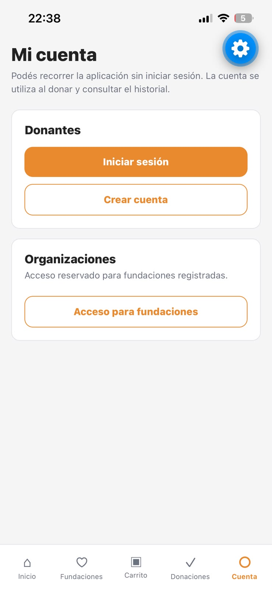
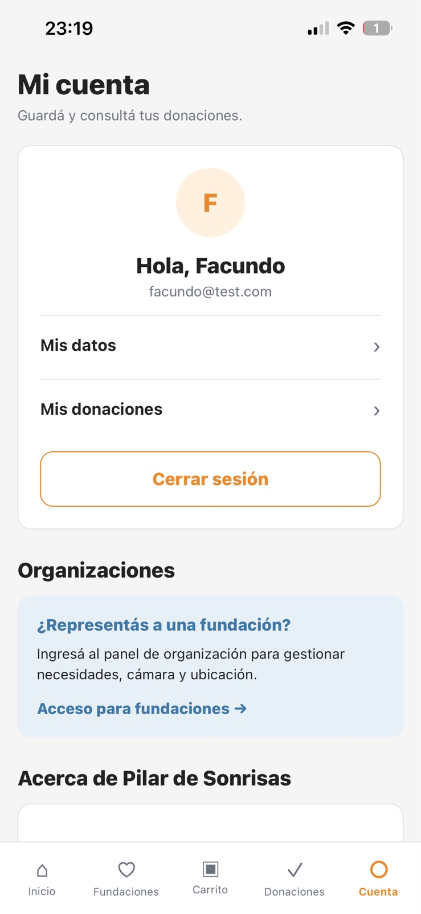
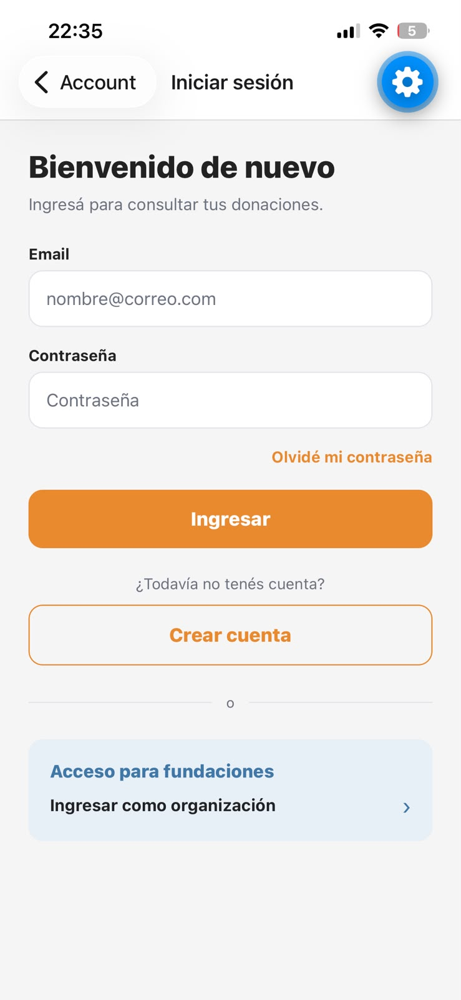
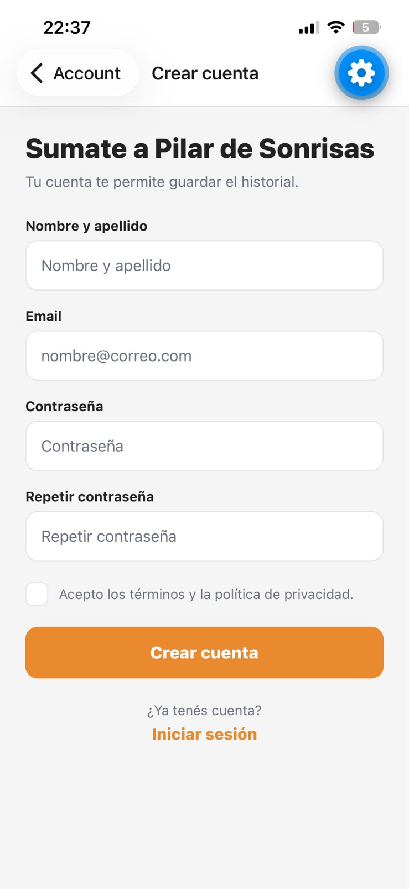
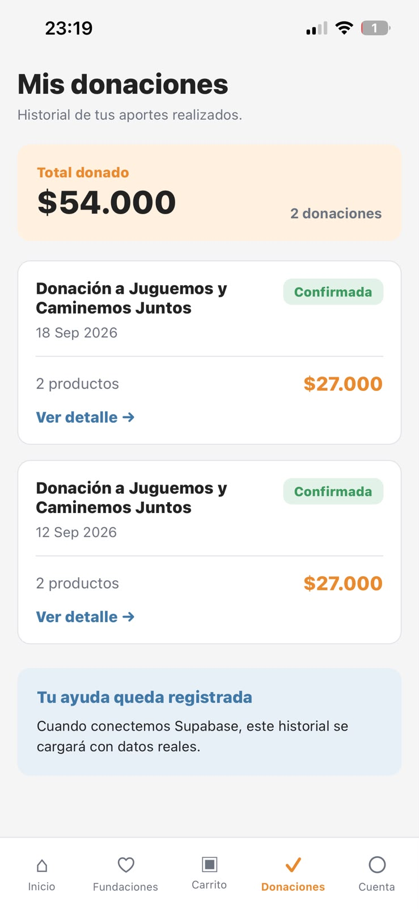
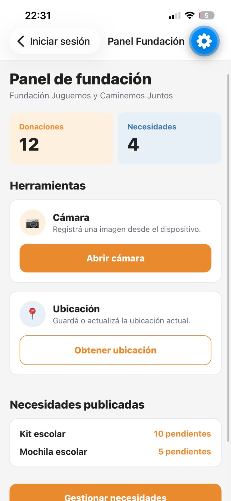

# Cuenta, autenticación y fundación

**Responsable:** Facundo  
**Requisitos relacionados:** RF-007, RF-008, RF-011, RF-012, RF-013, RF-015, RF-016  
**Rama:** `feature/facundo-auth-account`

## Qué hace el módulo

Agrupa el acceso de las dos clases de usuario de la aplicación. El donante entra
desde la pestaña Cuenta para iniciar sesión o registrarse y consultar su
historial de donaciones; la fundación entra a un panel propio donde dispone de
cámara y geolocalización. La navegación de la app no exige cuenta: se puede
recorrer el catálogo y armar el carrito sin sesión.

## Archivos principales

- `src/screens/AccountScreen.js`
- `src/screens/LoginScreen.js`
- `src/screens/RegisterScreen.js`
- `src/screens/DonationsScreen.js`
- `src/screens/FoundationPanelScreen.js`
- `src/state/session.js` (nuevo)

---

### AccountScreen.js

**Qué hace**

Punto de entrada de la cuenta. Muestra dos estados según haya sesión abierta o
no, y da acceso al ingreso de organizaciones.

**Navegación**

Se llega desde la barra inferior (Cuenta). Puede ir a Login, Register y
Donations.

**Funciones principales**

| Función | Qué hace |
|---|---|
| `handleLogout()` | Cierra la sesión simulada. |
| `handleMyData()` | Avisa que la edición de datos se habilita con Supabase. |
| `handleInfo()` | Avisa que las secciones informativas se completan más adelante. |

**Datos/estado que usa**

`getUser()`, `logout()` y `subscribe()` de `src/state/session.js`; `navigation`.

---

### LoginScreen.js

**Qué hace**

Resuelve el ingreso de las dos clases de usuario. Recibe por parámetro
`userType`: como donante muestra el formulario completo con recuperación de
contraseña, acceso al registro y un atajo al ingreso de organizaciones; como
fundación muestra solo el formulario.

**Navegación**

Se llega desde Cuenta o desde el propio login de donante. Va a FoundationPanel
si es fundación, o vuelve a Cuenta si es donante.

**Funciones principales**

| Función | Qué hace |
|---|---|
| `handleLogin()` | Valida los campos y resuelve el ingreso simulado según el tipo de usuario. |
| `handleForgotPassword()` | Avisa que la recuperación se habilita junto con Supabase. |

**Validaciones implementadas**

- Email y contraseña no pueden estar vacíos.

**Datos/estado que usa**

`email`, `password`, `route.params.userType`, `login()` de `session.js`.

---

### RegisterScreen.js

**Qué hace**

Alta visual de una cuenta de donante. No crea ningún usuario: el alta real queda
para Supabase Auth.

**Navegación**

Se llega desde Cuenta o desde Login. Vuelve a Cuenta con la sesión iniciada.

**Funciones principales**

| Función | Qué hace |
|---|---|
| `handleRegister()` | Valida el formulario y abre la sesión simulada. |

**Validaciones implementadas**

- Nombre, email y contraseña no pueden estar vacíos.
- Las dos contraseñas deben coincidir.
- Hay que aceptar los términos para continuar.

---

### DonationsScreen.js

**Qué hace**

Muestra el historial de donaciones del donante: total donado, cantidad de
donaciones y una tarjeta por cada una con fecha, estado, productos e importe.

**Navegación**

Se llega desde la barra inferior (Donaciones) o desde Cuenta con sesión abierta.

**Datos/estado que usa**

Constante `DONATIONS` con datos de ejemplo. El historial real vendrá de Supabase.

---

### FoundationPanelScreen.js

**Qué hace**

Panel de la organización. Muestra un resumen de donaciones y necesidades, las dos
herramientas de hardware y el listado de necesidades publicadas.

**Navegación**

Se llega desde Login con `userType: "foundation"`.

**Funciones principales**

| Función | Qué hace |
|---|---|
| `handleOpenCamera()` | Pide permiso de cámara y abre la vista de captura. |
| `handleTakePhoto()` | Toma la fotografía y guarda la URI para mostrarla. |
| `handleGetLocation()` | Pide permiso de ubicación y obtiene las coordenadas actuales. |
| `handleManageNeeds()` | Avisa que la gestión de necesidades se conecta más adelante. |

---

### session.js

**Qué hace**

Guarda la sesión simulada del donante fuera de las pantallas, para que no se
pierda al navegar entre Cuenta y Donaciones. Expone `login()`, `logout()`,
`getUser()` y `subscribe()`, que avisa a las pantallas suscriptas cuando la
sesión cambia.

No persiste si se cierra la aplicación y no toca `App.js` ni ningún archivo
compartido. Al conectar Supabase Auth se reemplaza este módulo y las pantallas
quedan igual.

---

## Cámara

- Archivo/función: `FoundationPanelScreen.js` — `handleOpenCamera()` y `handleTakePhoto()`
- Qué hace: abre la cámara a pantalla completa, permite tomar una fotografía con
  `takePictureAsync()` y muestra la imagen dentro de la tarjeta. La imagen no se
  sube a ningún servicio.
- Permisos utilizados: `useCameraPermissions()` de `expo-camera`. Si el permiso
  quedó bloqueado desde el sistema, la pantalla avisa que hay que habilitarlo
  desde la configuración del teléfono.

## Geolocalización

- Archivo/función: `FoundationPanelScreen.js` — `handleGetLocation()`
- Qué hace: obtiene la posición actual con `getCurrentPositionAsync()` y muestra
  latitud y longitud con seis decimales. No usa mapa.
- Permisos utilizados: `Location.requestForegroundPermissionsAsync()` de
  `expo-location`. Si se deniega, se muestra el motivo en pantalla.

## Prueba manual

1. Abrir la pestaña Cuenta: debe mostrar el estado sin sesión.
2. Entrar a Iniciar sesión y tocar Ingresar con los campos vacíos: avisa que
   faltan datos.
3. Ingresar un email y una contraseña: vuelve a Cuenta mostrando el saludo con
   el nombre.
4. Entrar a Mis donaciones y volver a Cuenta desde la barra inferior: la sesión
   se mantiene.
5. Tocar Cerrar sesión: vuelve al estado sin sesión.
6. Ir a Crear cuenta, completar los campos sin aceptar los términos: avisa que
   faltan los términos. Aceptarlos e intentar de nuevo: abre la sesión con el
   nombre cargado.
7. Entrar por Acceso para fundaciones con cualquier email y contraseña: abre el
   panel de fundación.
8. En el panel, Abrir cámara y sacar una foto: la imagen queda visible.
9. Tocar Obtener ubicación: aparecen latitud y longitud.

Resultado esperado: el recorrido completo funciona en Expo Go sobre un celular
real, sin errores en consola, con cámara y GPS operativos.

## Pendiente

- El historial de Mis donaciones usa datos de ejemplo.
- La sesión es simulada y no persiste al cerrar la aplicación.
- Mis datos y las secciones informativas de Cuenta solo muestran un aviso.

Todo esto queda a la espera de la conexión con Supabase.

## Capturas

